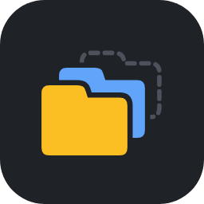

<div align="center">



# Tab Keeper

**Keeps only the last N tabs alive and discards the rest**. Predictable memory use with any number of open tabs.


</div>

---

A Helium / Chromium extension (Manifest V3). Only the N most recently used tabs stay alive; the rest are discarded with `chrome.tabs.discard`. A discarded tab is not closed: it stays in the tab strip and reloads when you click it.

Unlike the browser's built-in Memory Saver, which discards tabs on memory pressure or after a timeout, Tab Keeper holds a fixed number of live tabs. Memory use stays predictable no matter how many tabs are open.

## What is never discarded

- the N most recently used tabs (3 by default);
- the active tab in every window;
- tabs used within the last few seconds, so quick switching doesn't cause reloads;
- pinned tabs (configurable);
- tabs playing audio, plus N minutes after the audio stops (10 by default);
- tabs using the microphone, camera or screen sharing, so calls aren't dropped;
- internal pages (`chrome://`, extensions).

## Install

```bash
git clone git@github.com:PavelKhabusov/tab-keeper.git ~/helium-extensions/tab-keeper
```

1. Open `helium://extensions` (or `chrome://extensions`) and turn on Developer mode.
2. Click Load unpacked and pick the repository folder.
3. After updating: press ⟳ on the extension.

## Settings (popup)

| Setting | Default |
|---|---|
| Tabs to keep alive | 3 |
| Keep pinned tabs | on |
| Keep tabs playing audio | on |
| Keep tabs in a call | on |
| Keep after audio, min | 10 |
| Grace after use, sec | 8 |
| Check interval, min | 1 |

**Discard others now** discards tabs immediately, following the same rules. The popup also shows how many tabs are open, discarded, audible and in a call.

## How it works

`background.js` re-ranks tabs by `lastAccessed` on tab events (activate, create, load, window focus) and on a periodic alarm, since the service worker may be suspended. Everything outside the top N that isn't protected gets discarded.

Calls are detected by `call-detect.js`, which runs in the page's MAIN world at `document_start` in every frame. It wraps `getUserMedia` / `getDisplayMedia` and tracks live media tracks; while any is live, `call-bridge.js` reports it to the background every 5 seconds. Pages opened before the extension was installed or updated are only covered after a reload.

## Privacy

The extension requests access to all sites only to notice when a page turns on the microphone, camera or screen sharing. It never reads media content, and nothing leaves the browser.

## Files

- `manifest.json`: `tabs`, `storage`, `alarms` permissions and site access.
- `background.js`: ranking, discard logic, events, alarm.
- `call-detect.js`, `call-bridge.js`: microphone, camera and screen-share detection.
- `popup.html`, `popup.js`: settings and status.
- `icons/`, `assets/icon.png`: extension and README icons.
